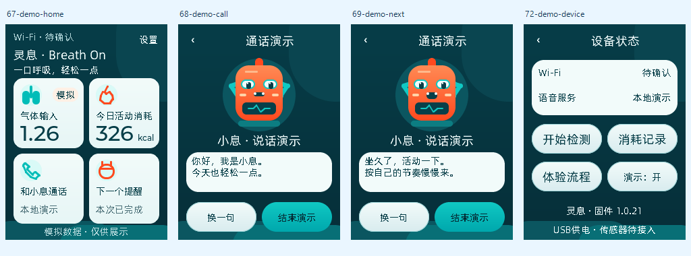
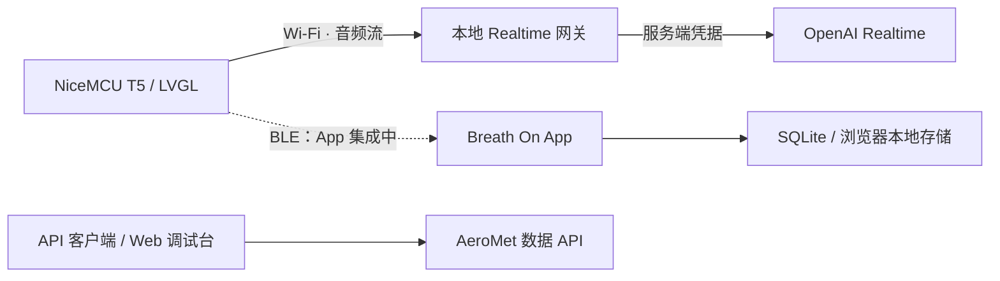

<p align="center"></p>

# 灵息 · Breath On

**把呼吸记录、日常提醒与语音陪伴放进一个小设备。**

Breath On（AeroMet）硬件与 App 的公开开发仓库：NiceMCU T5 固件适配、240 × 320 原生 LVGL 界面、Tauri App，以及数据 API / 实时语音网关。

这是开发中的原型。气体与热量数据包含模拟输入，不能作为真实检测结果或医疗结论；App 的 BLE 接入和板端真实语音仍在联调。此仓库没有发布可直接烧录的固件，也没有打包 Android / iOS 安装包。



*上图来自同一套 C / LVGL 代码的桌面测试渲染；通话页为本地演示状态，不是实时 AI 通话完成的证明。*

## 仓库内容

| 目录 | 内容 | 从这里开始 |
| --- | --- | --- |
| [`hardware/`](hardware/README.md) | NiceMCU T5 适配、Wi-Fi 恢复、BLE 协议、音频与实时语音、LVGL UI、主机测试 | [硬件说明](hardware/README.md) |
| [`app/`](app/README.md) | TypeScript / Vite 页面、Tauri 2 / Rust 本地数据库、BLE 数据帧解析 | [运行 App](app/README.md) |
| [`services/`](services/README.md) | FastAPI 数据接口、Web 调试台、OpenAI Realtime 网关、接口样例与测试 | [运行服务](services/README.md) |
| [`docs/`](docs/STATUS.md) | 能力边界、架构、验证记录、公开发布说明 | [当前进度](docs/STATUS.md) |

## 先看 App

需要 Node.js 22 与 pnpm。浏览器预览使用本地模拟数据，不需要开发板或 API Key。

```sh
cd app
pnpm install --frozen-lockfile
pnpm dev
```

打开终端输出的本机地址（默认 `http://localhost:1420`）。

```sh
pnpm build
node --experimental-strip-types --test tests/metabolism.test.ts
```

桌面版还需要 Rust 与 Tauri 的系统依赖，运行 `pnpm tauri dev`。本次发布验证范围见 [VALIDATION.md](docs/VALIDATION.md)。

## 当前进度

| 模块 | 本次公开快照的状态 |
| --- | --- |
| 显示与触摸 | NiceMCU ST7789 / CST816 适配已有板测记录；仓库提供原生 UI 与桌面测试程序 |
| 提醒与页面 | 首页、气体输入、热量、关系图、建议、提醒、状态页；部分数值为演示数据 |
| App | 浏览器预览与 Tauri 工程；设备实例仍为 `MockDevice`，未接成真实 BLE 传输 |
| BLE | 板端服务与 C 协议、App Rust 帧解析器已实现；硬件生成的读数仍是模拟值 |
| 实时语音 | 网关与板端代码已具备；上游音频测试曾通过，实板听说、打断与长时间稳定性待验收 |
| 气体、摄像头、传感器 | 本次未完成真实采集与校准验收 |

## 系统关系



App 的本地数据层与数据 API 目前是独立实现，图中的虚线表示尚未打通的路径。详见 [架构与协议](docs/ARCHITECTURE.md)。

## 公开范围与来源

本仓库是独立整理的源码快照，不包含原始工作目录历史、Wi-Fi 密码、API Key、设备 UUID / AuthKey、Flash 备份、用户记录或串口日志。所有凭据只在使用者自己的环境中配置。

第三方 SDK 和字体不整包上传，固定版本及获取方式见 [THIRD_PARTY.md](THIRD_PARTY.md)。公开可见不等于统一开源授权；各文件原有许可继续有效，自有代码与美术素材的授权范围见 [LICENSE.md](LICENSE.md)。
